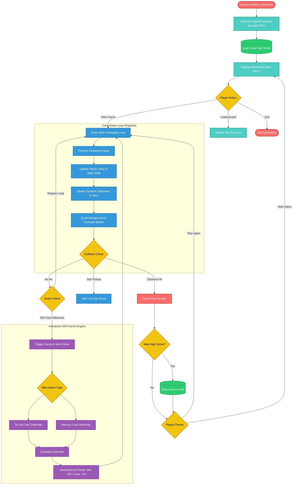

<p align="center">
  
</p>

<div align="center">
  <h1>EndlessRunner</h1>
</div>

<p align="center">
  <strong>A little running. A lot of dodging. An endless chase for the high score.</strong>
</p>

<p align="center">
  A 2D endless runner built with Python and Pygame, inspired by the classic Chrome Dinosaur Game.
</p>

<p align="center">
  
  
  
  
</p>

---

## Overview

EndlessRunner is a 2D arcade-style running game where players control a character navigating through an endless environment filled with obstacles, collectible stars, and interactive mini-games.

Jump over obstacles, slide under flying enemies, collect stars, complete mini-games, and push your score as high as possible. The game gradually increases in speed, making every run progressively more challenging than the last.

---

## Game Screenshots

<p align="center">
  
</p>

<p align="center">
  
</p>

---

## Key Features

- **Endless Gameplay** – Continuously generated obstacles with dynamic speed scaling.
- **Player Animations** – Fluid animated running, jumping, and ducking mechanics.
- **Dynamic Obstacles** – Avoid ground obstacles like books and airborne birds with unique trajectories.
- **Star Collection System** – Collect stars during your run for extra bonus points.
- **Interactive Mini-Games** – Triggered every 300 points for extra reward opportunities.
- **Local Leaderboard** – Tracks top 5 scores across playthroughs via local storage.
- **Interactive Game Menu** – Clean navigation for Start Game, Leaderboard, and Quit options.
- **Visual FX** – Animated backgrounds, dynamic clouds, star particles, and score notifications.

---

## Controls

| Action | Primary Key | Alternative Key |
| :--- | :--- | :--- |
| **Jump** | `SPACE` | `UP ARROW` |
| **Slide / Duck** | `DOWN ARROW` | — |
| **Pause / Return to Menu** | `ESC` | — |
| **Navigate Menu** | `UP ARROW` | `DOWN ARROW` |
| **Select Option** | `ENTER` | `SPACE` |
| **Continue Mini-Game** | `SPACE` / `ENTER` | Mouse Click |

---

## Architecture & Workflow Chart

<div align="center">



</div>

## Mini-Game Mechanics

Mini-games trigger automatically every 300 points during a active run.

| Match Outcome | Score Bonus |
| :--- | :--- |
| **Win** | +50 Points |
| **Draw** | +10 Points |
| **Lose** | +0 Points |
| **Skip** | +0 Points |

---

## Tech Stack

| Component | Technology / Library | Description |
| :--- | :--- | :--- |
| **Language** | Python 3.13 | Core game logic and state management |
| **Engine** | Pygame | Graphics rendering, window frame, collision, and inputs |
| **Graphics** | SVG Assets | Scalable vector graphics rendered dynamically |
| **Storage** | File I/O (`txt`) | Persistent local high score storage |

---

## Game Assets & Resources

Below is a breakdown of vector assets used inside the game graphics engine:

| Category | Asset File | Purpose |
| :--- | :--- | :--- |
| **Sprites** | `run1.svg`, `run2.svg`, `dino_duck.svg` | Player movement and state animations |
| **Enemies** | `bird1.svg`, `bird2.svg`, `book.svg` | Flying and ground obstacle entities |
| **Environment** | `background.svg`, `ground.svg`, `cloud.svg` | Dynamic scrolling background layers |
| **Collectibles** | `star.svg`, `star_small.svg`, `spark_gold.svg`, `spark_green.svg` | Score pickups and visual particle effects |
| **UI Components** | `banner.svg`, `menu_logo.svg`, `button.svg`, `button_hover.svg` | Menu headers, titles, and button states |
| **Panels** | `leaderboard_panel.svg`, `gameover_panel.svg`, `mini_panel.svg`, `dim.svg` | Modal popups, overlays, and game screens |
| **Mini-Game** | `ttt_board.svg`, `ttt_x.svg`, `ttt_o.svg`, `ttt_hover.svg`, `ttt_win.svg` | Tic-Tac-Toe mini-game visual assets |
| **Cards & Icons** | `card_back.svg`, `card_face.svg`, `card_hover.svg`, `card_matched.svg`, `icon_*.svg` | Memory card mini-game and status icons |

<div align="center">

### Environment & World

<br>
<sub><b>background.svg</b></sub>

### Player Animations

| Running (Frame 1) | Running (Frame 2) | Ducking / Sliding |
| :---: | :---: | :---: |
|  |  |  |
| `run1.svg` | `run2.svg` | `dino_duck.svg` |

### Obstacles & Collectibles

| Ground Obstacle | Flying Enemy (Frame 1) | Flying Enemy (Frame 2) | Pickup Star | Small Star |
| :---: | :---: | :---: | :---: | :---: |
|  |  |  |  |  |
| `book.svg` | `bird1.svg` | `bird2.svg` | `star.svg` | `star_small.svg` |

</div>

---

## Getting Started

### Prerequisites

Ensure you have Python 3 and `pip` installed on your system.

### Installation

1. **Clone the repository**
   ```bash
   git clone https://github.com/iabhnv19/EndlessRunner.git
   ```

2. **Navigate to project folder**
   ```bash
   cd EndlessRunner
   ```

3. **Install dependencies**
   ```bash
   pip install pygame
   ```

4. **Launch the game**
   ```bash
   python Endless_runner.py
   ```

---

## Project Structure

```text
EndlessRunner/
│
├── assets/
│   ├── background.svg
│   ├── banner.svg
│   ├── bird1.svg / bird2.svg
│   ├── book.svg
│   ├── run1.svg / run2.svg / dino_duck.svg
│   ├── star.svg / spark_*.svg
│   ├── ttt_*.svg
│   └── ... (all SVG game graphics)
│
├── Endless_runner.py
├── dinorunner_highscore.txt
├── .gitignore
├── LICENSE
└── README.md
```

---

## Limitations

- The game is a local single-player application and does not feature online multiplayer or remote leaderboards.
- High scores are saved in a local plain-text file (`dinorunner_highscore.txt`) without encryption or database backend.
- Frame rate and rendering speed are dependent on the host machine's hardware capabilities.
- Pygame must be installed locally to execute the application script directly.
- The application is designed for academic learning and demonstration, not commercial production use.

---

## Troubleshooting

<details>
<summary><b><code>python</code> or <code>pip</code> is not recognized</b></summary>

<br>

Python is either not installed or its installation folder is not available in your system's PATH.

- Download and install Python 3.x from [python.org](https://www.python.org/).
- Ensure **"Add Python to PATH"** is checked during installation.
- Open a new terminal and verify installation:

```bash
python --version
```

</details>

<details>
<summary><b>ModuleNotFoundError: No module named 'pygame'</b></summary>

<br>

Pygame package is missing in your active Python environment. Install it using `pip`:

```bash
pip install pygame
```

If using Python 3 explicitly on Linux or macOS:

```bash
pip3 install pygame
```

</details>

<details>
<summary><b>Asset loading errors / Missing file paths</b></summary>

<br>

Ensure you are launching the script from the root `EndlessRunner` repository directory where the `assets/` folder is located.

```bash
cd EndlessRunner
python Endless_runner.py
```

</details>

<details>
<summary><b>Game runs too fast or stutters</b></summary>

<br>

Check that your display driver is updated and no external frame rate limiters are locking Pygame window refresh rates.

</details>

---

## Future Improvements

- Add sound effects and dynamic background music.
- Introduce customizable character skins and unlockable visual themes.
- Implement online leaderboards powered by a cloud backend database.
- Add gamepad / controller support alongside keyboard inputs.
- Create cross-platform executable bundles (`.exe` / `.app`) for easier distribution.
- Add additional obstacle types and boss stage events.

---

## License

Distributed under the MIT License. See `LICENSE` for more information.

<br>

## Developer

Developed By 
<div align="center">

<table>
  <tr>
    <td align="center">
      <a href="https://github.com/iabhnv19">
        
        <br />
        <strong>Abhinav</strong>
        <br />
        @iabhnv19
      </a>
    </td>
  </tr>
</table>
</div>
<div align="center">
Made with ❤️ by [Abhinav](https://github.com/iabhnv19)<br>
 If this Project seems cool, consider starring the repo!
</div>
</div>
